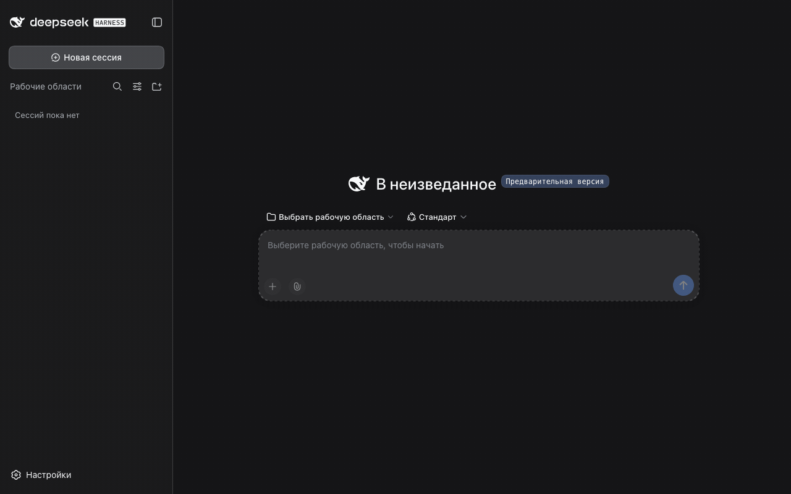
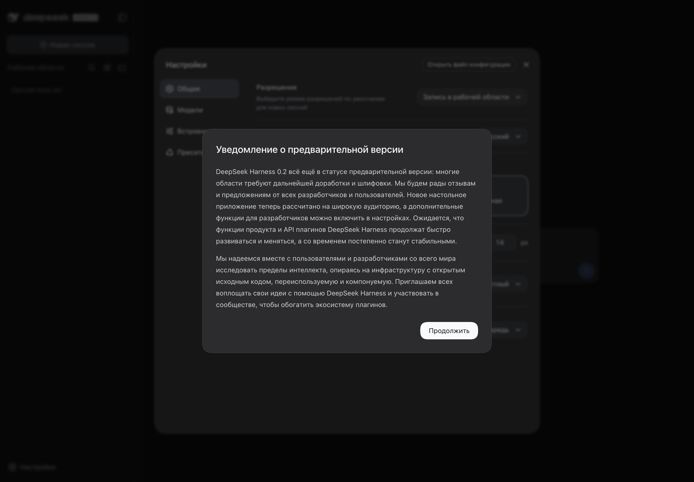

# dsh-locale-russian

Русская локализация web-интерфейса [DeepSeek Harness](https://github.com/deepseek-ai/deepseek-harness) — и русский голосовой ввод в комплекте: распознавание речи работает локально, без облака и API-ключей.

В DSH 0.2.2 появился **нативный русский язык**. Плагин это определяет и не перезаписывает нативные словари (иначе ломается загрузка стоковых плагинов); на более старых версиях работает собственный полный перевод. Сравнение и стратегия — в [docs/NATIVE-RU.md](docs/NATIVE-RU.md).

[](https://github.com/nemezida1337/dsh-locale-russian/actions/workflows/ci.yml)
[](https://www.npmjs.com/package/dsh-locale-russian)
[](https://www.npmjs.com/package/dsh-locale-russian)
[](https://github.com/nemezida1337/dsh-locale-russian/stargazers)
[](LICENSE)
[](https://nemezida1337.github.io/dsh-locale-russian/dashboard.html)
[](https://nemezida1337.github.io/dsh-locale-russian/)

## Быстрый старт

Приложение DeepSeek Harness — обычный случай:

```sh
npx dsh-locale-russian-install --desktop
```

Перезапустите приложение и выберите **Настройки → Общие → Язык → Русский**. Всё: интерфейс на русском, склонения («1 файл», «2 файла», «5 файлов») работают из коробки.

Сервер `dsh web`:

```sh
dsh plugin --profile web add dsh-locale-russian
```

Руками ничего запускать не обязательно: можно дать агенту ссылку на этот репозиторий — он поставит пакет сам. Подробности и частые вопросы — в [FAQ](https://github.com/nemezida1337/dsh-locale-russian/blob/main/docs/FAQ.md).

Голосовой ввод — вторая половина пакета. Он требует штатный плагин «Голосовой ввод» и один раз скачанный движок распознавания:

1. включите «Голосовой ввод» на странице «Плагины»;
2. откройте его карточку и нажмите **«Скачать и подготовить»** — движок и модель скачаются и настроятся сами;
3. перезапустите приложение и нажмите микрофон в поле ввода.

Подробности — в разделе [«Голосовой ввод»](#голосовой-ввод).

## Возможности

| Возможность | Что именно |
|---|---|
| Перевод интерфейса | 4096 строк в 77 namespace: панели, настройки, диалоги, карточки инструментов, подсказки, ошибки UI, единицы измерения и форматы дат |
| Описания плагинов | 564 строки: названия и описания карточек в разделе «Встроенные плагины» и в обзоре плагинов |
| Русские склонения | формы выбираются по `Intl.PluralRules('ru')`, а не по английскому правилу «1 или много» |
| Голосовой ввод | локальный распознаватель **GigaAM v3** для штатного голосового ввода: аудио не покидает машину, ключи не нужны, ставится одной кнопкой |
| Терминология | единый глоссарий ([GLOSSARY.md](GLOSSARY.md)) и правила стиля ([STYLE.md](STYLE.md)), проверяемые линтером |
| Быстрая диктовка | Режим **`auto`**: GigaAM отвечает за **0,15–0,22 с** на обычном русском, Whisper подключается только на английских терминах и транслитерациях. Тёплый `whisper-server` и предзагрузка движков |
| Гибридная диктовка | **GigaAM + Whisper**: на корпусе — **8,6% ошибок в словах** и **98% верных терминов**; длинные записи режутся по паузам, prompt Whisper в формате «Термины: …» |
| Динамические словари | Профили «работа / проект / личное», переключение из окна словаря и автоматически по контексту; лимит 400 слов на словарь, а не на всё |
| Статистика и чистка | Счётчики `×N` у слов и замен, retention неиспользуемых слов с предпросмотром и «Вернуть», импорт словаря по URL |
| Восстановление диктовки | Если транскрипт не попал в поле ввода — панель «Вставить / Скопировать», текст хранится 30 минут |
| Словарь в интерфейсе | окно по **Cmd/Ctrl+Shift+D**: слова и замены, поиск, добавление, импорт из буфера, переключение движка и стратегии слияния |
| Подсветка и правка | заменённые термины подсвечиваются синим, подсказки — жёлтым; клик по слову открывает варианты и «Вернуть как было» |
| Обучение через агента | попросите в чате «дообучи на моей терминологии» — агент добавит слова и замены и объяснит, как пользоваться |
| Установка одной командой | пакет, встроенный Whisper без Homebrew, модель с прогрессом и настройка гибрида — за одно действие |
| Установка | один пакет: ставится из npm, git, tarball или локального пути |

Пакет — обычный клиентский плагин DSH: он добавляет язык `ru` в расширяемый каталог локалей и регистрирует переводы для всех namespace интерфейса. Недостающие ключи автоматически показываются по-английски, поэтому неполный перевод не ломает интерфейс. Одновременно это bundle, поэтому ставится одной командой и обновляется как обычный пакет.

Строки сняты из трёх источников: клиентских пакетов установленного приложения (`app.asar`), CLI-сборки и репозитория. Пропущенных ключей нет — актуальные цифры и разбивка по namespace на [дашборде покрытия](https://nemezida1337.github.io/dsh-locale-russian/dashboard.html).

## Что нового

**0.25.2 — хотфикс:** recovery больше не дублирует и не путает диктовки, настройки и словарь не зависают при недоступном хосте, а слияние не переносит фразы из начала в конец.

**0.25.0 — скорость, динамические словари и совместимость с DSH 0.2.2.**

- **Режим `auto` по умолчанию:** GigaAM ~0,15–0,22 с на русском; Whisper — только на английских терминах, транслитерациях и низкой уверенности. Тёплый `whisper-server`, предзагрузка обоих движков.
- **Длинные диктовки:** нарезка аудио по тихим точкам, prompt «Термины: …», выравнивание предложений по смыслу — пунктуация восстановлена, абзацы не теряются.
- **Динамические словари:** профили контекста, лимит 400 на словарь, автопереключение, статистика пользы, retention-чистка, импорт по URL.
- **DSH 0.2.2:** нативный русский больше не перезаписывается — плагин не мешает стоковым плагинам и корректно работает на новых и старых версиях.
- **Восстановление диктовки:** панель «Вставить / Скопировать», если текст не попал в поле ввода.
- Подробности — в [CHANGELOG.md](https://github.com/nemezida1337/dsh-locale-russian/blob/main/CHANGELOG.md). Гайды: [словарь](docs/DICTIONARY.md), [замены](docs/REPLACEMENTS.md), [тюнинг через агента](docs/COACHING.md).

## Как выглядит





## Установка

Пакет не требует форка DeepSeek Harness и не меняет его файлы.

### Профиль web (сервер `dsh web`)

```sh
dsh plugin --profile web add dsh-locale-russian
```

Команда ставит пакет из npm через pnpm, добавляет его в `dependencies` и `dsh.profile.bundles`, после чего строка `locale-ru` появляется в собранном дереве.

Если сразу после выпуска pnpm ставит предыдущую версию — так работает его защита от слишком свежих пакетов; укажите версию явно (`dsh-locale-russian@0.7.2`) или повторите позже. `npm` в такой ситуации ставит актуальную версию сразу.

Так же пакет ставится из git или локального пути:

```sh
dsh plugin --profile web add github:nemezida1337/dsh-locale-russian
dsh plugin --profile web add file:/абсолютный/путь/к/рабочей/копии
```

### Приложение DeepSeek Harness (desktop)

Профиль `desktop` принадлежит Electron-приложению, и CLI отказывается им управлять. Пакет ставится одной командой: она находит профиль, делает резервную копию, добавляет зависимость и строку бандла, ставит пакет встроенным pnpm приложения, проверяет результат, **ставит Whisper из встроенного prebuilt** (Homebrew не нужен) и докачивает модель ~574 МБ и **настраивает гибридный движок** в профиле. Одно действие — рабочий гибрид:

```sh
npx dsh-locale-russian-install --desktop
```

Флаги: `--engine auto|gigaam|whisper|hybrid` (по умолчанию `auto`: GigaAM отвечает сразу, Whisper подключается только на английских терминах), `--merge auto|sentences|text|words`, `--no-whisper` (остаться на GigaAM), `--whisper-model <путь>`.

```sh
npx dsh-locale-russian-install --desktop
```

Полезные режимы: `--dry-run` — показать изменения без записи, `--revert` — откатить установку, `--profile <путь>` — другой каталог DSH.

**Без терминала:** включите «Пользовательские рынки плагинов» на странице «Плагины», откройте вкладку «Обзор» → «Источники индексов», добавьте адрес `https://nemezida1337.github.io/dsh-locale-russian/index.json` и установите пакет из «Обзора».

**Вручную:** добавьте `"dsh-locale-russian": "^0.25.2"` в `~/.dsh/profiles/desktop/package.json` и `dsh-locale-russian` в его `dsh.profile.bundles`, затем выполните `pnpm add dsh-locale-russian` в каталоге профиля. pnpm лежит внутри приложения: `…/DeepSeek Harness.app/Contents/Resources/runtime/primary-runtime/dependencies/pnpm/bin/pnpm.mjs`.

**Строкой патча** — когда нужна живая рабочая копия: возьмите копию репозитория в постоянное место и добавьте в `~/.dsh/profiles/desktop/cordis.patch.yml`, сохранив остальные записи:

```yaml
- insert:
    - id: locale-ru
      name: file:///абсолютный/путь/к/dsh-locale-russian/lib/index.js
```

После любого способа перезапустите приложение. Язык выбирается в **Настройках → Общие → Язык**; если система и браузер приложения настроены на русский, интерфейс переключится сам.

### Удаление

- приложение: `npx dsh-locale-russian-install --desktop --revert` (или удалите пакет на странице «Плагины»);
- web-профиль: `dsh plugin --profile web remove dsh-locale-russian`.

Движок и модель голосового ввода остаются в `~/.dsh/bin` и `~/.gigastt` — их можно удалить вручную.

## Голосовой ввод

Пакет — не только словари: его хост-половина (`lib/index.js`) регистрирует в штатном реестре `speechToText` провайдера **`gigaam-local`**, поэтому микрофон, волна, Stop/Cancel и вставка текста остаются штатными, а распознавание идёт на машине через [gigastt](https://github.com/ekhodzitsky/gigastt) и модель **GigaAM v3** (`e2e_rnnt`, INT8, 271 МБ) от [SberDevices](https://github.com/salute-developers/GigaAM).

### Одна кнопка

1. Включите «Голосовой ввод» на странице «Плагины» — это штатный плагин DSH, в поставке он выключен.
2. Откройте его карточку и нажмите **«Скачать и подготовить»**. Провайдер сам скачает движок для вашей платформы (macOS arm64, Linux x64/arm64, Windows x64) с проверкой контрольной суммы релиза, распакует его в `~/.dsh/bin`, затем скачает модель в `~/.gigastt/models` и запустит её. Прогресс обоих шагов виден в карточке.
3. Перезапустите приложение — в настройках голосового ввода появится `GigaAM v3 (локально, RU)`.

Если русский распознаватель выбран по умолчанию, движок прогревается в фоне через несколько секунд после запуска: первая диктовка не ждёт загрузки модели.

Если движок или модель удалить, та же кнопка восстановит их. Альтернатива для терминала — `npx dsh-locale-russian-install`. На платформах без готовой сборки возьмите [релиз gigastt](https://github.com/ekhodzitsky/gigastt/releases) вручную и укажите `binaryPath` в настройках плагина.

### Движки: GigaAM, Whisper и гибрид

Пакет умеет работать на двух движках и комбинировать их:

- **GigaAM v3** (по умолчанию) — лучший на русской речи: 6.57 % WER на аудиокнигах, 6.95 % на спонтанной речи.
- **Whisper large-v3-turbo** — лучше на английских терминах: на фразах с латиницей 7.89 % против 10.27 % у GigaAM (по [открытому бенчмарку](https://github.com/vakovalskii/stt-ru-benchmark)).
- **Гибрид (sentences, по умолчанию)** — запускает оба параллельно и сливает посентенционно: для каждого предложения берётся вариант с лучшей оценкой (термины из словаря минус искажённая латиница). Оба движка получают словарь: GigaAM через hotwords, Whisper через `--prompt`. На корпусе из 10 смешанных фраз: GigaAM 27.7% WER, Whisper 11.3%, **гибрид — 8.6%** при 97% точности терминов. Другие стратегии: `merge: sentences|text|auto|words` (пословное — экспериментальное).

Включается в патче профиля:

```yaml
- id: locale-ru
  config:
    engine: hybrid          # gigaam | whisper | hybrid
    whisperBinaryPath: /opt/homebrew/bin/whisper-cli
    whisperModelPath: ~/.dsh/speech-ru/whisper/ggml-large-v3-turbo-q5_0.bin
```

Для Whisper нужны `whisper-cli` (например, `brew install whisper-cpp`) и модель `ggml-large-v3-turbo-q5_0.bin` (~574 МБ). Гибрид добавляет ~1–1.5 ГБ памяти и около секунды задержки.

### Лимит диктовки

Пакет поднимает штатный лимит записи с 2 до **5 минут** (и объём аудио с 4 до 10 МиБ — на 300 секунд в формате 16 кГц/моно нужно ~9,2 МиБ). Движок распознаёт такую запись примерно за 15 секунд. Изменить лимит можно в патче профиля — строка `api-speech-to-text`, причём менять нужно оба значения:

```yaml
- id: api-speech-to-text
  config:
    maxDurationSeconds: 600      # 10 минут
    maxAudioBytes: 20971520      # 20 МиБ
```

### Личный словарь

Движок не знает ваших терминов — он может услышать «конфиг хотводс» вместо `configHotwords`. Для этого есть личный словарь: он хранится отдельной секцией в `~/.dsh/speech-ru/hotwords.txt` и подмешивается к распознаванию.

**Подробные гайды:** [docs/DICTIONARY.md](docs/DICTIONARY.md) — словарь (добавление, подсветка, авто-обучение, CLI); [docs/REPLACEMENTS.md](docs/REPLACEMENTS.md) — замены; [docs/COACHING.md](docs/COACHING.md) — тюнинг через разговор с агентом.

**Первичное заполнение** — из терминала, списком или файлом:

```sh
npx dsh-locale-russian-install --hotwords-add "configHotwords, GigaAM, dsh-locale-russian"
npx dsh-locale-russian-install --hotwords-add-file terms.txt   # по одному слову в строке
pbpaste | npx dsh-locale-russian-install --hotwords-add-file - # список из буфера (stdin)
npx dsh-locale-russian-install --hotwords-list                 # посмотреть словарь
npx dsh-locale-russian-install --hotwords-remove "GigaAM"
npx dsh-locale-russian-install --hotwords-export terms.json    # выгрузить словарь и замены
npx dsh-locale-russian-install --hotwords-import terms.json    # загрузить (например, от коллеги)
npx dsh-locale-russian-install --hotwords-from .              # собрать термины из проекта
```

**Из проекта:** `--hotwords-from <папка>` сканирует исходники (имена файлов, компонентов, camelCase/PascalCase-идентификаторы), ранжирует по частоте и берёт самые полезные — по умолчанию 150 (`--hotwords-limit`). Служебные слова, React-хуки, `node_modules` и обрывки уже существующих фраз («Harness» при «DeepSeek Harness») пропускаются. Повторный запуск заменяет слова прошлого сканирования (манифест `projects.json` рядом со словарём), поэтому сканирование можно повторять после рефакторинга. Найденное видно и удаляется в панели «Словарь (N)».

**Пополнение прямо из распознанного текста:** выделите слово в поле ввода — рядом появится поповер с кандидатами из словаря (фонетическое сопоставление: «гитхаб» → `GitHub`) и пунктом «+ в словарь». Выбрали кандидата — слово в поле заменилось, а пара «как услышали → как надо» запомнилась. Нажали «+ в словарь» — фраза просто попала в словарь. В поповере есть строка «Словарь (N)» — открывает весь список с кнопками «×» для удаления. Если выделенное слово уже есть в словаре, поповер предлагает «− убрать из словаря». Это явные действия, ничего не правится молча. Дубликаты слов сравниваются без учёта регистра: «GitHub» и «github» — одно слово.

**Авто-обучение из правок:** править слово вручную не обязательно — если после диктовки вы исправили слово в поле, пара «как услышали → как надо» запоминается сама. Учится только терминология: ссылки, числа, код, служебные слова, склонения и смысловые правки пропускаются. Неуверенные исправления не запоминаются молча — плагин спросит «Запомнить исправление?». Внизу появится «Выучено: гитхаб → GitHub».

Замены хранятся в `~/.dsh/speech-ru/replacements.json` и **применяются автоматически** к каждой расшифровке: если движок услышал «гитхап», в поле появится `GitHub`, а внизу — уведомление «Словарь: заменено 1: гитхап → GitHub». Это видимая правка, а не молчаливая. Hotwords подсказывают написание, но не всегда пересиливают акустику, поэтому выученные пары — надёжный путь для терминов, которые произносят по-русски.

Лимит личного словаря — 400 фраз (движок читает файл целиком, ограничение в 64 фразы относится только к HTTP-запросу). После изменения словаря движок один раз перезагружается: первая диктовка будет на ~5 секунд дольше.

### Диктовка в фоне

Штатный голосовой ввод отменяет запись, когда окно теряет фокус: переключились на браузер — диктовка пропадала. Пакет это исправляет: запись продолжается, а состояние видно по трём признакам — бейдж «● Диктовка идёт в фоне» в окне приложения, точка «●» в заголовке окна и системное уведомление. Вернувшись в приложение, нажмите «Стоп» — текст распознается и вставится как обычно; если не возвращаться, запись остановится сама по лимиту длительности.

### Провайдер по умолчанию

Провайдер появляется в списке «Сервис распознавания» и выбирается в настройках. Чтобы русский распознаватель был выбором по умолчанию сразу, добавьте в `~/.dsh/profiles/<профиль>/cordis.patch.yml`:

```yaml
- id: speech-to-text
  config:
    defaultProvider: gigaam-local
```

Сам пакет тоже несёт этот патч, но он применяется только если бандл голосового ввода идёт в `dsh.profile.bundles` **раньше** нашего: патчи применяются по порядку слоёв. Строка в патче профиля применяется последней и работает при любом порядке; выбор, сделанный в настройках, её перекрывает.

### Словарь распознавания (hotwords)

Точные написания фирменных слов и терминов лежат в `~/.dsh/speech-ru/hotwords.txt` — по фразе на строку, правки подхватываются со следующей диктовки без перезапуска. Встроенный список: `DeepSeek Harness`, `DSH`, `GigaAM`, `gigastt`. Слишком похожие фрагменты одной фразы добавлять не стоит: конкурирующие записи портят результат.

### Приватность

- Аудио обрабатывается локально: движок слушает только `127.0.0.1` на случайном порту, в сеть ничего не отправляется.
- API-ключи и подписки не используются; модель и движок — обычные файлы на диске.
- Пакет не собирает телеметрию: единственный сетевой обмен — npm при установке и загрузка движка с моделью по вашему явному действию.

### Если голосовой ввод не нужен

Ничего делать не нужно: без включённого бандла голосового ввода хост-половина не активируется, перевод работает как обычно. Движок и модель не скачиваются, пока вы сами не нажмёте кнопку подготовки.

## Проверка после установки

1. **Язык:** «Настройки → Общие → Язык» — выбран «Русский», интерфейс по-русски.
2. **Страница:** в исходнике страницы `html lang="ru"`.
3. **Голосовой ввод:** «Плагины → Голосовой ввод → Сервис распознавания» — в списке есть `GigaAM v3 (локально, RU)`, статус «Готов». Кнопка микрофона записывает и вставляет текст.

## Диагностика

`GET http://127.0.0.1:47118/last-transcription` отдаёт последнюю диктовку: `raw`, `text`, `applied`, `mode`, а также `words[]` с таймингами слов (`{word, start, end, confidence}`, секунды от начала аудио), `gigaamText` и `audioDurationSeconds` — по ним внешние клиенты (например, Chronoflow) привязывают пометки к моменту речи.

| Симптом | Причина | Что сделать |
|---|---|---|
| Интерфейс остался английским | язык не выбран или пакет не в композиции | «Настройки → Общие → Язык» → «Русский»; проверьте `dsh plugin --profile <имя> list` и перезапустите приложение |
| Часть строк по-английски | ключ новый и ещё не переведён | штатное поведение: недостающие ключи падают в английский; обновитесь до свежей версии пакета |
| В «Сервис распознавания» нет `GigaAM v3` | не включён штатный «Голосовой ввод» или не установлен наш пакет | включите «Голосовой ввод» на странице «Плагины», установите пакет, перезапустите |
| Провайдер есть, но не выбран по умолчанию | порядок слоёв: наш патч применился раньше | выберите в настройках или добавьте строку в патч профиля (см. [выше](#провайдер-по-умолчанию)) |
| «Не удалось скачать движок» | нет сети или недоступен GitHub | повторите кнопку «Скачать и подготовить»; при блокировке скачайте [релиз gigastt](https://github.com/ekhodzitsky/gigastt/releases) вручную и укажите `binaryPath` |
| «Модель GigaAM не подготовлена» | модель удалена или не докачана | карточка «Плагины → Голосовой ввод» → «Скачать и подготовить» |
| Диктовка путает термины | словарь не знает ваших слов | допишите фразы в `~/.dsh/speech-ru/hotwords.txt` |
| Пакет не загружается, в логе `engines.dsh` | версия DSH вне диапазона | обновите пакет — диапазон расширяется с проверкой новых сборок |

Логи приложения: `~/Library/Logs/DeepSeek Harness/` (macOS). Покрытие переводов — на [дашборде](https://nemezida1337.github.io/dsh-locale-russian/).

## Как это работает

1. Плагин объявляет язык: `ctx.locale.addLanguage({ id: 'ru', label: 'Русский', fallback: 'en' })`.
2. Для каждого namespace регистрируется словарь: `ctx.locale.register(namespace, 'ru', {...})`. Ключи совпадают с оригинальными, значения — русские.
3. Русские склонения: словарь может хранить до трёх форм, разделённых `|`, а пакет подменяет `LocaleRuntime.prototype.translate`, выбирая форму по числу. Для не-`ru` локалей вызывается исходный метод, поэтому английский и китайский интерфейсы работают как раньше.
4. Метаданные плагинов: описания и названия приходят от хоста как `LocalizedText` и рисуются через `LocaleRuntime.resolveText`; пакет подменяет и этот метод. Если пакет отдаёт свой русский вариант, он выигрывает.
5. Голосовой ввод: хост-половина регистрирует провайдера `gigaam-local` в штатном реестре `speechToText`; движок прогревается в фоне, когда провайдер выбран по умолчанию, и запускается при первой диктовке в остальных случаях.

В DSH `0.2.2` русский язык и небольшие словари `common`/`settings` встроены в ядро: пакет дополняет их — занятые слоты не мешают активации, а перевод для них накладывается поверх. Подробнее о формате форм — в [STYLE.md](STYLE.md#множественные-числа).

## Совместимость

- `engines.dsh` в манифесте (`^0.1.5-rc.1 || ^0.2.1-rc.2 || ^0.2.2-alpha.2`) перечисляет проверенные сборки: `0.1.5-rc.x` (CLI-сборка, клиентские пакеты `0.1.5-rc.2`), CLI-сборки `0.2.1-rc.2`…`rc.4`, приложения `0.2.1-rc.3` и `0.2.1-rc.5` (клиентские пакеты распакованы из `app.asar`) и `0.2.2-alpha.2` из тега `alpha`. Пропусков нет: в `0.2.1-rc.5` нет ни одной новой строки, одна удалена, английский текст не менялся.
- Голосовой ввод проверен в живой композиции с бандлом голосового ввода и без него; тест хост-половины входит в `npm test`.
- Пакет использует публичный контракт локали (`addLanguage`, `register`, `getSnapshot`) и два приватных метода рантайма: `translate` для склонений и `resolveText` для метаданных плагинов. Оба вызова защищены проверкой типа: если метод исчезнет, пакет продолжит работать — склонения перестанут выбираться, описания плагинов останутся английскими, строки интерфейса не пострадают.
- Обсуждения в upstream: [хук склонений](https://github.com/deepseek-ai/deepseek-harness/discussions/10147), [локализация оболочки](https://github.com/deepseek-ai/deepseek-harness/discussions/10148) и [локализуемые описания навыков](https://github.com/deepseek-ai/deepseek-harness/discussions/11533); тексты — в [contrib/upstream-issues.md](contrib/upstream-issues.md), витрина плагина — [discussions/10146](https://github.com/deepseek-ai/deepseek-harness/discussions/10146).

## Участие

- Вопросы по установке, голосовому вводу и обновлению — [FAQ](https://github.com/nemezida1337/dsh-locale-russian/blob/main/docs/FAQ.md) и [обсуждения репозитория](https://github.com/nemezida1337/dsh-locale-russian/discussions) (категории «Вопросы» и «Идеи»).
- Нашли ошибку перевода — [issue по шаблону](https://github.com/nemezida1337/dsh-locale-russian/issues/new?template=translation-error.yml).
- Предлагаете правку — [CONTRIBUTING.md](CONTRIBUTING.md): правила перевода, порядок выпуска и как добавить новый язык генератором `tools/scaffold-locale.mjs`.
- Покрытие по namespace и источникам — [дашборд](https://nemezida1337.github.io/dsh-locale-russian/).
- Ответы в обсуждениях DeepSeek Harness проверяет еженедельный workflow и при новом комментарии открывает issue в этом репозитории.
- Мейнтейнерам — [docs/DEVELOPMENT.md](docs/DEVELOPMENT.md) (инструменты, CI, выпуски) и [docs/MAINTENANCE.md](https://github.com/nemezida1337/dsh-locale-russian/blob/main/docs/MAINTENANCE.md) (чек-лист обслуживания: новая версия DSH, движок, жалобы на перевод).

## Сайт

- **Сайт плагина:** https://nemezida1337.github.io/dsh-locale-russian/ — возможности, установка, гайды.
- **Дашборд покрытия:** https://nemezida1337.github.io/dsh-locale-russian/dashboard.html
- **Индекс плагинов:** https://nemezida1337.github.io/dsh-locale-russian/index.json

## Ссылки

| Что | Адрес |
|---|---|
| Пакет в npm | https://www.npmjs.com/package/dsh-locale-russian |
| Релизы и история изменений | https://github.com/nemezida1337/dsh-locale-russian/releases |
| Дашборд покрытия | https://nemezida1337.github.io/dsh-locale-russian/dashboard.html |
| Индекс маркета (для «Плагины → Обзор») | https://nemezida1337.github.io/dsh-locale-russian/index.json |
| Витрина в обсуждениях DSH | https://github.com/deepseek-ai/deepseek-harness/discussions/10146 |
| Предложение: хук склонений | https://github.com/deepseek-ai/deepseek-harness/discussions/10147 |
| Предложение: локализация оболочки | https://github.com/deepseek-ai/deepseek-harness/discussions/10148 |
| Предложение: локализуемые описания навыков | https://github.com/deepseek-ai/deepseek-harness/discussions/11533 |
| Рецепт плагина для DSH | [contrib/plugin-recipe.md](contrib/plugin-recipe.md) |
| DeepSeek Harness | https://github.com/deepseek-ai/deepseek-harness |
| gigastt (движок распознавания) | https://github.com/ekhodzitsky/gigastt |
| GigaAM (модель) | https://github.com/salute-developers/GigaAM |

## О проекте

Неофициальная локализация, не связанная с DeepSeek. Модель GigaAM распространяется по лицензии MIT её авторами; движок `gigastt` — отдельный проект со своей лицензией. Пакет распространяется по лицензии [MIT](LICENSE).
